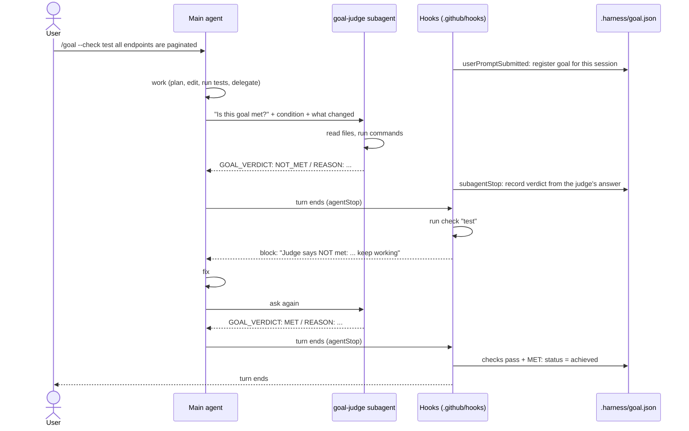

# How `/goal` works

Claude Code's `/goal` sets a completion condition; after every turn a separate model checks whether the condition holds, and if not, the agent starts another turn instead of handing control back. It is a wrapper around a Stop hook.

GitHub Copilot has the same hook. The `agentStop` event fires when the main agent finishes a turn, and a hook that answers `{"decision": "block", "reason": "..."}` forces another turn with `reason` as its prompt. This skeleton builds `/goal` on that.

## The loop



Four hooks take part:

| Event | Script | What it does |
|---|---|---|
| `userPromptSubmitted` | `on-prompt.mjs` | Sees the raw prompt. If it starts with `/goal`, it writes the goal to `.harness/goal.json`, bound to the session that typed it. |
| `subagentStop` | `goal-verdict.mjs` | When the `goal-judge` subagent finishes, reads `GOAL_VERDICT:` and `REASON:` from its answer and stores them. A judge answer without a verdict is sent back to the judge. |
| `agentStop` | `goal-stop.mjs` | The decision. Runs the goal's required checks, then looks for a verdict. Blocks or releases the turn. |
| `sessionStart` | `session-start.mjs` | Tells a new or resumed session about a goal that is still open. |

The `/goal` skill is the part the model reads: it explains the protocol, confirms the goal is registered, and tells the agent to start working and to finish through the judge.

## What decides that a goal is met

Two things, in this order:

1. **Required checks**, if the goal names any with `--check`. These are commands from `goal.checks` in `.github/hooks/harness/config.json`. The stop hook runs them itself and blocks if one fails, passing the end of the output to the agent. This is deterministic: no model is involved.
2. **The judge's verdict.** `goal-judge` is a subagent with its own context. It gets the condition and a list of places to look, inspects the repository, runs what it needs, and ends with a verdict line. The hook takes the verdict from the judge's own answer when the judge finishes.

The agent doing the work never decides that it is done. That is the property that makes `/goal` in Claude Code useful, and the reason the verdict is captured by a hook instead of being written by the working agent.

With `--no-judge` (which requires at least one `--check`) the checks alone decide.

### Differences from Claude Code's evaluator

| | Claude Code `/goal` | This harness |
|---|---|---|
| Who evaluates | A small fast model, given the condition and the conversation | A subagent that reads the repository and runs commands, plus optional deterministic checks |
| When | Automatically after every turn | The agent calls the judge when it believes it is done; the stop hook insists on a verdict before the turn can end |
| Cost | Evaluator tokens every turn | A subagent run per verification |
| Evidence | The transcript | The actual files and command output |

Copilot hooks are commands, so they cannot call the session's model directly. That is why evaluation is a subagent the agent must invoke, with the hook enforcing that it happened.

## Autopilot's progress check or `/goal`?

VS Code has a built-in feature aimed at the same problem. In Autopilot mode the agent continues across turns until it decides your request is complete. With the experimental setting `chat.autopilot.advanced.enabled`, a separate model checks progress against your original request after each turn, and if it finds unfinished work, its feedback guides the next turn. That is the same idea as Claude Code's evaluator, and it needs no hooks, no scripts and no Node.js.

The documentation describes it in one paragraph, so several rows below say "not documented". It has not been compared side by side with `/goal` in a live session yet.

| | Autopilot with the advanced check | `/goal` in this harness |
|---|---|---|
| What is checked | Your original request, as the checking model understands it | A condition you wrote for the purpose, stored apart from the conversation |
| Hard checks | None | Named commands that must exit 0, run by the hook itself |
| Who judges | A second model. What it can see is not documented | A subagent that reads the repository and runs commands |
| Setup | One setting, plus choosing Autopilot mode | Hooks, Node.js, and a policy that allows repository hooks |
| When hooks are restricted to managed sources | Works | Falls back to a convention |
| Where it applies | Autopilot mode in VS Code | Any mode, and Copilot CLI |
| Lifetime | The current request | Until met, cleared or exhausted, across your later messages; can be resumed in a new session |
| Limits | Not documented | Turn budget you set, plus the runtime's cap of 8 forced turns in a row |
| Maturity | Experimental setting | Built on hooks, which are in preview |

So it does not replace `/goal`, and for a good share of everyday work it makes `/goal` unnecessary:

- **Use Autopilot with the check** when the request itself says what done means and a model's judgement is enough: implement this feature, fix this bug, finish this refactor.
- **Use `/goal`** when done has to be proven rather than judged (the test suite must pass, the linter must be clean), when the condition must survive several prompts or a restart, or when you are not in Autopilot mode.

Both can be on at once. If your team finds the built-in check sufficient, the goal machinery can be removed without touching the rest: delete `.github/skills/goal`, `.github/agents/goal-judge.agent.md`, and every hook entry except `preToolUse` from `.github/hooks/harness.json`. The subagents, the workflow skills and the guard do not depend on it.

## Writing a good condition

The judge holds the condition to its words. Make them checkable.

| Weak | Better |
|---|---|
| the tests are fixed | `npm test` exits 0 with no skipped tests |
| pagination works | every list endpoint under `src/api` accepts `limit` and `cursor`, and each has a test for the last page |
| clean up the module | `src/billing` has no function longer than 60 lines and the existing tests pass unchanged |

State boundaries in the condition when they matter: "without changing the public API", "without adding dependencies". The judge checks those too.

Use `--check` for anything that has a command. A check cannot be argued with.

## Limits and safeguards

- **Turn budget.** A goal allows `maxTurns` stop attempts (default 20, `--max-turns` to change). On the last one the agent is told to summarise what remains. After that the goal is marked `exhausted` and the turn ends. `/goal resume` resets the budget.
- **Runtime cap.** The Copilot runtime ends a turn after 8 consecutive forced continuations, whatever a hook says. The goal stays active; your next message continues it. Autopilot mode, which is built to continue across turns, is a good companion.
- **Session binding.** A goal holds only the session that set it. Other sessions in the same folder see a note at session start and can adopt it with `/goal resume`.
- **Hook timeout.** The stop hook has 900 seconds (`timeoutSec` in `harness.json`), each check has `checkTimeoutSec` (default 300). A hook that times out fails open: the agent simply stops. Keep checks fast, or raise both values.
- **Hook errors fail open.** If a script crashes, the turn ends normally. The goal is never the reason a session becomes unusable. `/goal clear` or deleting `.harness/goal.json` always releases it.

## Why checks are named, not free text

The stop hook runs check commands outside the agent's tool approval flow. If a goal could carry an arbitrary command, anything that can influence the agent (a poisoned issue, a web page) could get a command executed without approval. So a goal can only reference a check by name, and the commands live in `config.json`, which is reviewed like code. The guard hook asks for confirmation before the agent edits anything under `.github/hooks/`.

Protect `.github/hooks/`, `.github/agents/` and `.github/skills/` with CODEOWNERS and branch protection.

## The verdict relay fallback

Capturing the verdict depends on the `subagentStop` event carrying the judge's name and answer. If two stop attempts in a row find no captured verdict, the hook assumes capture is not working in this environment and allows the agent to record the judge's verdict with:

```text
node .github/hooks/harness/goal.mjs verdict <MET|NOT_MET|IMPOSSIBLE> "<reason>"
```

Before that point the command is refused. The relay is weaker, because the working agent passes the verdict on, so if you see it used regularly, find out why capture fails (see below).

## Troubleshooting

Turn on the event trace to see exactly what the runtime sends to each hook:

```text
mkdir -p .harness && touch .harness/debug     # then reproduce, then read .harness/events.log
```

The trace contains shortened prompts and tool arguments. It is local and gitignored. Remove `.harness/debug` when you are done.

| What you see | Likely cause and fix |
|---|---|
| The agent stops although a goal is active | The session is not on the Copilot harness, or hooks are blocked by policy, or Node.js is missing where the agent runs. Check **Chat: Open Customizations > Hooks**, then the trace. If `events.log` has no `goal-stop.mjs` lines, the hook is not being run. |
| `/goal ...` is not registered until the agent runs `goal.mjs set` | The runtime did not deliver the raw slash command to `userPromptSubmitted`. Harmless: the skill's fallback registers it. The goal is then bound to the first session that reaches a stop. |
| The hook keeps asking for the judge although the judge answered | The trace shows what `subagentStop` delivers. If the agent name differs from `goal-judge`, set `goal.judgeAgent` in `config.json`. If no `subagentStop` event arrives at all, the relay fallback takes over. |
| A check fails in the hook but passes in your terminal | The hook runs from the repository root with the runtime's environment, which may lack your shell's PATH additions or environment variables. Use full commands in `goal.checks`. |
| The loop ends after 8 continuations | The runtime cap. Send any message to continue. |
| You want out | `/goal clear`, or `node .github/hooks/harness/goal.mjs clear`, or delete `.harness/goal.json`. |

## Without hooks

If your organisation allows hooks only from managed sources, the scripts in `.github/hooks/` do not run and nothing can force another turn. The `/goal` skill still tells the agent to work until the judge returns MET, which is a convention the model follows rather than a guarantee. Combine it with Autopilot and `chat.autopilot.advanced.enabled` for the closest built-in behaviour, and see [enterprise.md](enterprise.md) for distributing the hooks as a managed plugin.

## References

- [GitHub Copilot hooks reference](https://docs.github.com/en/copilot/reference/hooks-reference): `agentStop` input, decision control, the 8-block runaway guard, exit codes
- [Configure agent hooks in VS Code](https://code.visualstudio.com/docs/agent-customization/hooks)
- [Autopilot mode](https://code.visualstudio.com/docs/agents/run/approvals#autopilot-mode)
- [Claude Code `/goal`](https://code.claude.com/docs/en/goal)
